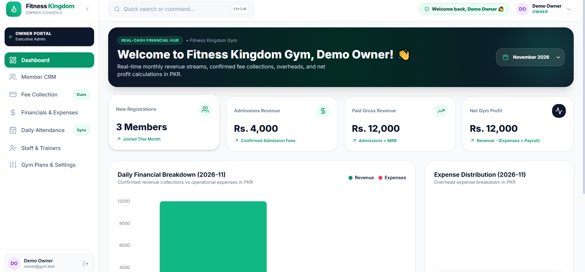
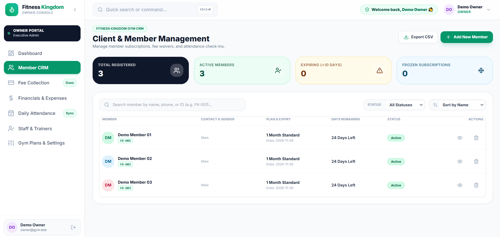
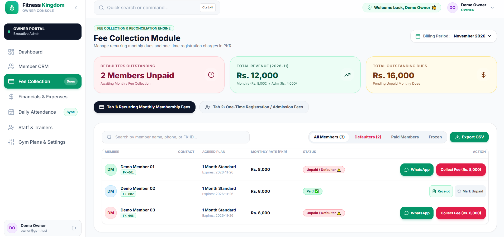

# Fitness Kingdom Gym — Member and Payment Portal

A React/Firebase application for one gym to manage members, admission/monthly payments, attendance, expenses and trainer payroll.

## Status

Firestore access requires a trusted owner custom claim. The maintainer supplied successful Firebase deployment output and reports passing owner login, record access, session refresh, signed-out protection and non-owner denial checks. These live results are maintainer-reported. This is a single-gym application. A localhost-only synthetic demo is available using Firebase emulators.

## Stack

React 18, JavaScript, Vite, Firebase Authentication/Firestore, Tailwind CSS and Recharts.

## Setup and checks

Use Node.js 22.12 or newer in the Node 22 line. The Firebase CLI emulator command also requires Java 21.

```sh
npm ci
cp .env.example .env.local
npm run dev
```

On Windows, use `Copy-Item .env.example .env.local`. Configure a separate Firebase test project with synthetic member/payment records. Read [owner-access setup](docs/OWNER-ACCESS.md) before using any privileged workflow.

```sh
npm test
npm run test:rules:ci
npm run build
```

## Build output and deployment

`dist/` and temporary Vite configuration bundles are generated files and are not versioned. A fresh checkout must run `npm ci` and `npm run build` before a Hosting deployment. Firebase Hosting serves the locally generated `dist/` directory; removing tracked copies does not remove the deployed website.

Run deployments only from a reviewed revision with the intended Firebase project configuration. Do not deploy placeholder environment settings or a portfolio demo to the operational gym project.

## Main workflows

- Member registration, membership status, renewal and freeze/unfreeze.
- Separate admission and recurring monthly fee workflows.
- Payment records, expenses, attendance, trainer payroll and CSV exports.
- Owner profile/password settings and WhatsApp reminder links.

These are implementation areas, not a claim that every edge case has passed a live acceptance test. WhatsApp links prepare messages; they do not send automated reminders.

## Authorization

Firestore permits access only to users with a trusted boolean `owner` custom claim. A stored profile role, email address, cached browser value or confirmation PIN does not authorize database operations. Owner provisioning must use trusted Admin SDK credentials outside the repository.

The client-side PIN remains a confirmation convenience, not an additional security factor. Member mutations reject failed writes before updating their cache. Registration keeps entered details for retry; member and attendance actions display an error. Ten unit tests cover write rejection and confirmed-write cache behaviour. Other service modules still need a separate failure-handling review.

## Portfolio demo

Run a disposable local demo without production credentials or real gym records:

```sh
npm ci
npm run demo
```

Open the loopback URL printed by Vite. Demo owner: **owner@gym.test / DemoGym123!**. These credentials apply only to local emulators. Stopping the command discards emulator data; the seed supplies three fictional members and one plan. Payments and attendance start empty so reviewers can exercise the workflow.

See [demo setup and walkthrough](docs/DEMO.md). Demo mode uses the fixed `demo-fitness-kingdom` project, requires a localhost browser host and connects Auth/Firestore to local emulators. Never deploy this mode to the operational gym project.

### Screenshots

**Local demo with synthetic data.** Captured by the maintainer during a manual walkthrough. Displayed payments are fictional; they are not evidence of business revenue, customer usage or production results.



<details>
<summary>Member management and fee collection</summary>





</details>

### Validation and limitations

- CI: 26 unit tests, four Firestore rule tests, production/demo builds, and synthetic owner access plus non-owner/anonymous denial checks passed for the billing-calendar change.
- Maintainer walkthrough: registration and refresh persistence, admission/monthly payments, attendance, sign-out and viewer denial reported passing. Supplied desktop captures show the current month and consistent fictional payment totals.
- Billing defaults to the local current month. Before a known membership start month, unpaid members show “Not yet joined” with no collection action; existing recorded payments remain visible.
- Mobile behaviour, accessibility, CSV export and payroll edge cases still need dedicated validation. Screenshots do not establish those checks.
- Other service modules need further write-failure handling review. The latest maintainer-supplied full dependency audit reports 16 moderate findings; an audit result does not prove application security.

## Contribution and use

Repository maintainer: [Agha Shoaib Zaib](https://github.com/BSSE23048). This is business-specific software; keep real member, payment and identity information out of demos and source control.

Custom built for Fitness Kingdom Gym. All rights reserved.
